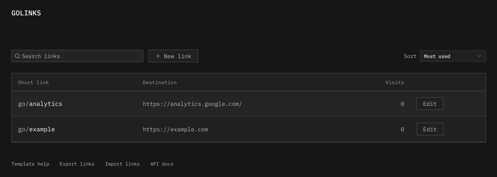

# Golinks

Self-hosted short links with Go URL templates, SQLite storage and an embedded
Svelte UI. Management is open to everyone who can reach the service; use it on
a trusted network.



## Local development

Requires Go 1.25, Node 26, pnpm 10 and just.

```zsh
pnpm --dir frontend install --frozen-lockfile
```

Start the API and frontend in separate terminals:

```zsh
just api
just frontend
```

Open [http://127.0.0.1:5173](http://127.0.0.1:5173).
The frontend uses Kit UI controls and semantic CSS with a fixed charcoal dark
theme inspired by OpenCode.

## Build

```zsh
just check
just build
./golinks
```

The Go executable embeds the frontend. `GOLINKS_ADDR` selects the listen address,
defaulting to `127.0.0.1:8080`; `GOLINKS_DATABASE` selects the SQLite file.
Open [http://127.0.0.1:8080](http://127.0.0.1:8080).

## Container image

```zsh
docker run -d --name golinks \
  -p 127.0.0.1:8080:8080 \
  -v golinks-data:/data \
  -e GOLINKS_PUBLIC_URL=http://localhost:8080 \
  ghcr.io/danielfrg/golinks:latest
```

Open [http://localhost:8080](http://localhost:8080). Images support Linux AMD64
and ARM64. `latest` tracks `main`; version tags such as `0.1.0` and image digests
can pin deployments. For a reverse proxy, set `GOLINKS_PUBLIC_URL` to its origin.
Bind-mounted data directories must be writable by UID/GID 65532.

The [Docker workflow](.github/workflows/docker.yml) validates images on pull
requests. The Dockerfile runs frontend tests, type checks and build, then Go tests
and vet before compiling the embedded server. Pushes and manual runs on `main`
publish `latest` and `sha-<commit>` tags; version releases also publish semver tags.
Publishing uses the built-in `GITHUB_TOKEN`.

## Config

| Variable                | Default                                      |
| ----------------------- | -------------------------------------------- |
| `GOLINKS_ADDR`          | `127.0.0.1:8080`                             |
| `GOLINKS_DATABASE`      | `./data/golinks.db`                          |
| `GOLINKS_PUBLIC_URL`    | `http://127.0.0.1:8080`                      |
| `GOLINKS_READONLY`      | `false`                                      |
| `GOLINKS_API_TARGET`    | `http://127.0.0.1:8080` (frontend dev proxy) |

For another local port:

```zsh
GOLINKS_ADDR=127.0.0.1:8082 GOLINKS_PUBLIC_URL=http://127.0.0.1:8082 ./golinks
```

## Links and templates

Names are case-insensitive and ignore hyphens: `meeting-notes` and `MeetingNotes`
resolve to the same link. Extra path segments are appended to plain destinations.
Incoming query parameters are merged with destination parameters.

Destination templates use `.Path`, `.Now` (UTC), and `PathEscape`, `QueryEscape`,
`TrimPrefix`, `TrimSuffix`, `ToLower`,
`ToUpper`, and `Match`. For example:

```text
https://www.google.com/{{if .Path}}search?q={{QueryEscape .Path}}{{end}}
```

Use Try a path in the editor to preview a destination. Add `+` to a short link
to open its details. API documentation is at `/_/api/docs`.

## Deployment

The container listens on port 8080 and stores its database at `/data/golinks.db`.
Override `GOLINKS_DATABASE` to use another path. Keep one instance per database;
existing click-history tables are upgraded transactionally when needed.

Readiness and liveness endpoints are `/_/readyz` and `/_/healthz`.

Build and verify an image locally:

```zsh
just image-check
```

## Backups

Use **Export links** and **Import links** in the footer to transfer JSONL backups
between instances. Links, templates, timestamps and total visits are preserved.
An optional CSV from `/_/export-stats` also preserves click history. Existing names
are skipped; invalid backups make no partial changes. Browser imports accept up
to 8 MiB of files combined. Larger backups use the CLI:

```zsh
GOLINKS_DATABASE=./data/restored.db ./golinks import \
  --links /path/to/golinks.jsonl --stats /path/to/golinks-stats.csv
```

## License

[Apache-2.0](LICENSE). Dependency and reused component licenses are listed in
[third-party notices](THIRD_PARTY_NOTICES.md).
